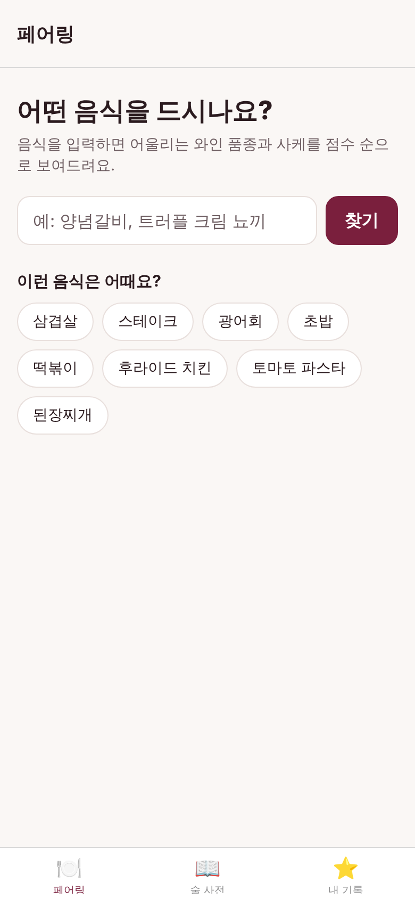
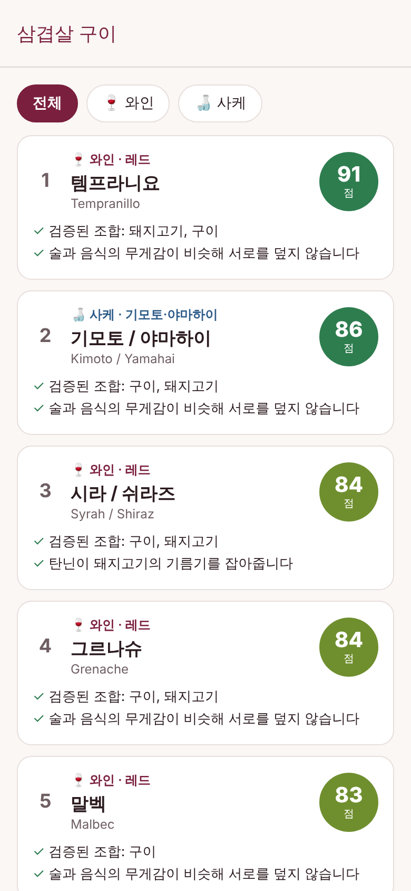
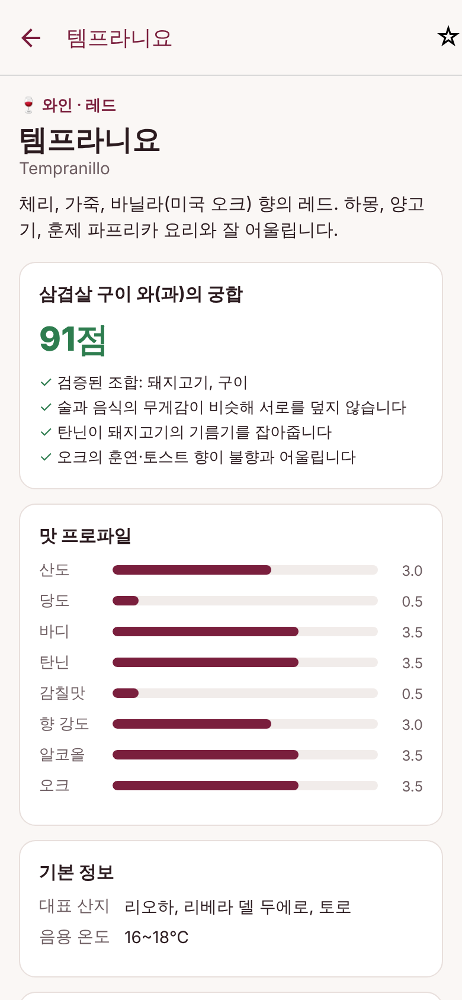
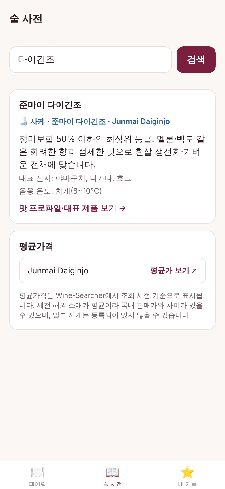

# 먹는거 먼저 (와인·사케 페어링 앱)

음식을 입력하면 **와인 품종과 사케 유형을 페어링 점수 높은 순**으로 보여주는 모바일 앱입니다.
술 이름을 입력하면 간단한 설명을 보여주는 **술 사전**과, **Wine-Searcher 평균가격 확인** 링크가 들어 있습니다.

| 홈 | 페어링 결과 | 상세 | 술 사전 |
|---|---|---|---|
|  |  |  |  |

## 설치형 웹앱 (링크·QR로 공유)

**https://vmo940417.github.io/wine-sake-pairing/**

`main` 에 웹 관련 변경이 올라가면 `.github/workflows/pages.yml` 이 GitHub Pages 에 배포합니다.
받는 사람은 가입이나 앱스토어 없이 링크를 열면 바로 쓸 수 있고, 홈 화면에 설치하면 앱처럼 전체 화면으로 열리며 오프라인에서도 동작합니다.
공유용 QR 카드는 `docs/qr-card.png` 입니다.

- 안드로이드: 크롬에서 링크 열기 → 화면 위 **앱 설치** 버튼, 또는 오른쪽 위 ⋮ → **앱 설치**
- 아이폰: 사파리에서 링크 열기 → 공유 버튼 → **홈 화면에 추가**

## 휴대폰 웹 버전 (서버 불필요)

`web/` 은 서버 없이 휴대폰 브라우저에서 바로 쓰는 단일 HTML 버전입니다.
데이터와 점수 엔진(`web/engine.js`, Python 엔진의 이식본)이 페이지 안에 들어 있어 오프라인으로도 동작합니다.
DB에 없는 음식은 키워드로 추정하며, 제품 AI 요약은 서버 버전에서만 제공됩니다.

```bash
python3 web/build.py   # Python 엔진과 결과 대조 후 web/dist/index.html 생성
```

빌드 스크립트는 DB 음식 64종 + 키워드 추정 음식 5종 × 술 38종의 점수와 이유가 Python 엔진과 완전히 같은지 확인하고, 다르면 빌드를 멈춥니다.
점수 규칙을 바꿀 때는 `server/app/engine/scoring.py` 와 `web/engine.js` 를 함께 고치세요.

## 구성

```
server/   FastAPI 백엔드 (Python)
  data/beverages.json   와인 품종 28종 + 사케 유형 10종, 맛 프로파일·설명·대표 병
  data/foods.json       한식·일식·양식·중식·디저트 64종, 맛 프로파일
  app/engine/scoring.py 규칙 기반 페어링 점수 엔진
  app/services/         음식 분석(키워드/Claude), 가격 링크, 페어링 조합
  app/main.py           API 엔드포인트
web/      서버 없는 휴대폰 웹 버전 (단일 HTML)
app/      Expo(React Native) 모바일 앱, Expo Router (서버 없이 동작)
  src/app/(tabs)/       페어링 · 술 사전 · 내 기록 탭
  src/app/pairing.tsx   점수 순위 화면 (전체/와인/사케 필터)
  src/app/beverage/     품종 상세 (맛 프로파일, 궁합 이유, 가격 링크)
```

## 페어링 점수 계산

술과 음식을 같은 0~5 맛 축으로 표현한 뒤, 기본점 62점에 규칙별 가감점을 더해 1~99점으로 자릅니다.
같은 입력이면 항상 같은 점수가 나오도록 점수 계산에는 LLM을 쓰지 않습니다.

| 규칙 | 내용 |
|---|---|
| 무게감 | 술 바디와 음식 풍미 강도가 비슷하면 가점, 차이가 크면 감점 |
| 산도 ↔ 지방 | 기름진 음식에 산도 높은 술 가점 |
| 음식 신맛 | 음식이 술보다 시면 감점 |
| 탄닌 | 붉은 고기·돼지고기 가점, 해산물·크림소스·매운맛·쓴맛과는 감점 |
| 매운맛 | 적당한 단맛 가점, 높은 알코올 감점 |
| 단맛 | 디저트보다 덜 단 술 감점, 식사에 너무 단 술 감점 |
| 감칠맛 | 사케 감칠맛 × 음식 감칠맛 가점, 강한 감칠맛 × 탄닌 감점 |
| 짠맛 | 산도·단맛과 균형 가점 |
| 오크 | 섬세한 음식 감점, 구이·바비큐 가점 |
| 검증된 조합 | 품종별 클래식 페어링 태그 일치 시 가점 |

가중치는 `server/app/engine/scoring.py` 에서 조정하고, `server/tests/test_api.py` 의 클래식 조합 테스트로 회귀를 확인합니다.

## 음식 입력 처리

1. 음식 DB(이름·별칭)에서 찾습니다.
2. 없으면 `ANTHROPIC_API_KEY` 가 설정된 경우 Claude가 맛 프로파일을 추정합니다 (결과는 서버 메모리에 캐시).
3. 키가 없거나 실패하면 이름의 키워드(돼지·회·매운·튀김 등)로 대략 추정합니다. 결과 화면에 추정 방식이 표시됩니다.

## 가격 표시 방식 (비용 0원)

Wine-Searcher 공식 API는 유료이고 스크래핑은 이용약관 위반이라, 앱 안에 가격을 직접 표시하지 않습니다.
대신 품종별 대표 병마다 **Wine-Searcher 검색 결과 링크**를 두고, 누르면 인앱 브라우저로 열려 조회 시점의 최신 평균가를 확인합니다.
나중에 API를 계약하면 `server/app/services/price_links.py` 만 바꿔 앱 안에 가격을 표시할 수 있습니다.

## 실행

### 서버

```bash
cd server
python3 -m venv .venv && .venv/bin/pip install -r requirements.txt
PYTHONPATH=. .venv/bin/uvicorn app.main:app --reload --port 8000
```

Claude 기능을 쓰려면 실행 전에 `export ANTHROPIC_API_KEY=...` (선택).

테스트:

```bash
cd server && .venv/bin/python -m pytest
```

### 앱

앱은 서버 없이 기기 안에서 점수를 계산합니다 (`web/engine.js` + `web/engine-data.json` 공유).

```bash
cd app
npm install
npx expo start
```

휴대폰에 Expo Go 앱을 설치하고 터미널의 QR 코드를 찍으면 바로 실행됩니다. `w` 를 누르면 브라우저 미리보기가 열립니다.

### 안드로이드 설치 파일 (APK)

`main` 에 앱 관련 변경이 올라가면 GitHub Actions(`.github/workflows/android-apk.yml`)가 APK를 빌드합니다.
Actions 탭에서 **Android APK → Run workflow** 로 직접 실행할 수도 있습니다.
결과는 실행 화면의 Artifacts 와 `apk` 브랜치의 `wine-sake-pairing.apk` 로 받습니다.
개인 설치용으로 디버그 키 서명이며, 휴대폰에서 "출처를 알 수 없는 앱 설치"를 허용해야 설치됩니다.

## API

| 메서드 | 경로 | 설명 |
|---|---|---|
| GET | `/pairing?food=삼겹살&type=wine` | 점수 순 페어링 (type 생략 시 와인+사케) |
| GET | `/foods/search?q=갈비` | 음식 자동완성 |
| GET | `/beverages`, `/beverages/{id}` | 품종·유형 목록, 상세 + 가격 링크 |
| GET | `/dictionary?q=바롤로` | 술 사전 (품종 설명 또는 제품 AI 요약 + 가격 링크) |
| GET | `/health` | 상태, Claude 활성 여부 |

## 다음 단계

- 음식 DB 확장 (현재 64종 → 300종 이상)
- 사용자 평점을 점수에 반영하는 개인화
- 서버 배포 (Fly.io·Render 등) 후 앱 빌드(EAS)
